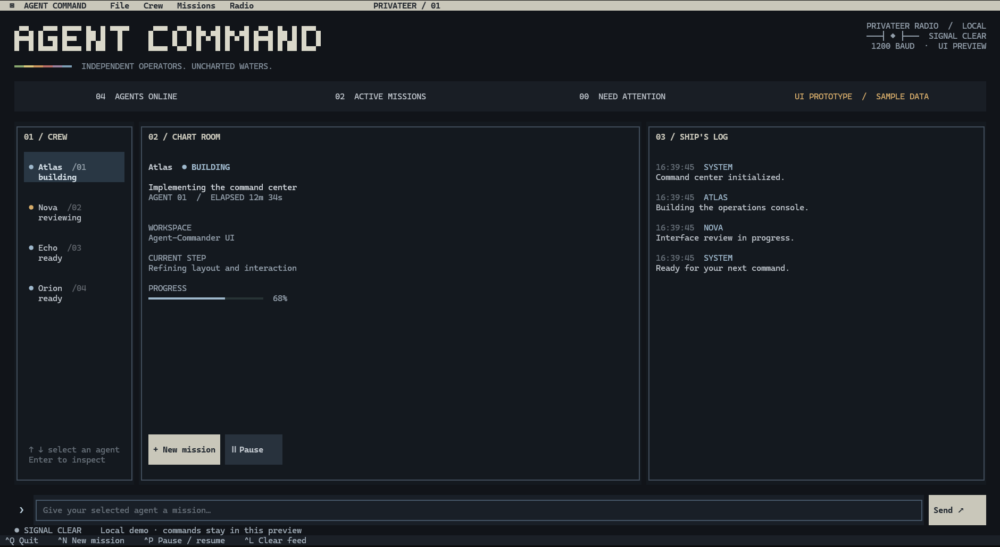

# Agent Command

## What we're working on

A Rust terminal interface for managing agents: a selectable crew roster, mission controls, command input, and an activity feed. The current prototype uses sample agents; commands stay local.

The interface retains its existing layout, block-letter backdrop, muted blue palette, ivory menu bar, and small color accent.

## Starter terminal

The current starter screen with sample agents and local mission controls:



The header and palette in detail:


## Install and open

No Rust, Cargo, Python, or administrator access needed. Paste the command for your system; it downloads the prebuilt Rust app, verifies its checksum, installs it for your user, and opens the terminal UI.

**macOS / Linux**

```sh
curl -fsSL https://raw.githubusercontent.com/Agent-Commander/Agent-Command/main/install/install.sh | sh
```

**Windows PowerShell**

```powershell
irm https://raw.githubusercontent.com/Agent-Commander/Agent-Command/main/install/install.ps1 | iex
```

After installation, open a new terminal and run:

```sh
agent-command
```

The command is `agent-command`, so tools already named `agent` are unaffected. Installers support x64 and ARM64 Windows, Intel/Apple Silicon macOS, and x64/ARM64 Linux. Linux packages use musl to avoid a distribution-specific glibc requirement. A Unicode terminal is required.

The release installers require a published release with matching platform assets. First-release publication is pending. Re-running the installer updates the app. Close an existing instance before updating on Windows.

Optional theme overrides use `AGENT_COMMAND_THEME`, or `agent-command/theme.toml` under `XDG_CONFIG_HOME`, Windows `APPDATA`, or `~/.config`.

### Build from source

With Rust/Cargo 1.99 or newer:

```sh
cargo install --locked --git https://github.com/Agent-Commander/Agent-Command --branch main --bin agent-command
```

From a source checkout, `cargo run --locked` also opens the UI.

Use a Unicode terminal at least 120 columns by 40 rows for the complete layout. Smaller terminals have a compact title.

## UI development

```sh
cargo run --locked --bin dev
```

Save `theme.toml` to refresh colors in place. Invalid theme edits keep the last working palette. Save Rust source to rebuild and restart automatically; demo state resets after a rebuild. The development supervisor and application are both Rust.

Controls: arrows select an agent, Tab changes focus, Ctrl+N focuses command input, Enter sends a local demo command, Ctrl+P pauses/resumes, Ctrl+L clears the feed, and Ctrl+Q exits. The roster and action buttons also accept mouse clicks. Menu-bar labels remain decorative.

## Validation

```sh
cargo fmt --check
cargo clippy --locked --all-targets -- -D warnings
cargo test --locked --all-targets
```

CI checks Windows, Linux, and macOS. No Python runtime is required.
