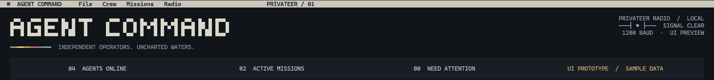

# Agent Command

## What we're working on

A Rust terminal interface for managing agents: one persistent entry bot, Commander, plus on-demand specialists with isolated workspaces, a selectable crew roster, mission controls, command input, and an activity feed.

The interface retains its existing layout, block-letter backdrop, muted blue palette, ivory menu bar, and small color accent.

## Starter terminal

The current starter screen with sample agents and local mission controls:


The header and palette in detail:



## Install and open

No Rust, Cargo, Python, or administrator access needed. Paste the command for your system; it downloads the prebuilt Rust app, verifies its checksum, installs it for your user, and opens the terminal UI.

**macOS / Linux**

```sh
curl -fsSL https://raw.githubusercontent.com/Agent-Commander/Agent-Command/main/install/install.sh | sh
```

**Windows PowerShell**

```powershell
irm https://raw.githubusercontent.com/Agent-Commander/Agent-Command/main/install/install.ps1 | iex
```

After installation, open a new terminal and run:

```sh
agent-command
```

The command is `agent-command`, so tools already named `agent` are unaffected. Installers support x64 and ARM64 Windows, Intel/Apple Silicon macOS, and x64/ARM64 Linux. Linux packages use musl to avoid a distribution-specific glibc requirement. A Unicode terminal is required.

The installers download the latest published release. Re-running the installer updates the app. Close an existing instance before updating on Windows.

At launch, release builds check once for a newer release in the background and show a one-line banner; press F6 or click it to dismiss. Nothing installs automatically. Run `agent-command update` to install a newer release (on Windows it prints the PowerShell command). Turn the launch check off in Settings, or set `AGENT_COMMAND_NO_UPDATE_CHECK=1` to skip it regardless of Settings. Development builds never check.

## Uninstall

Paste the command for your system. It removes `agent-command`, its empty install folder, and only the PATH lines the installer added. It honors `AGENT_COMMAND_INSTALL_DIR` and is safe to run twice.

**macOS / Linux**

```sh
curl -fsSL https://raw.githubusercontent.com/Agent-Commander/Agent-Command/main/install/uninstall.sh | sh
```

**Windows PowerShell**

```powershell
irm https://raw.githubusercontent.com/Agent-Commander/Agent-Command/main/install/uninstall.ps1 | iex
```

Sign-ins and app data are kept: profiles in `~/.local/share/sub-auth` (or `SUB_AUTH_DIR`) and `theme.toml` stay where they are. To sign out, run `agent-command auth logout PROVIDER PROFILE` before uninstalling. If you also installed with Cargo, run `cargo uninstall agent-command`. Close Agent Command first on Windows.

Optional theme overrides use `AGENT_COMMAND_THEME`, or `agent-command/theme.toml` under `XDG_CONFIG_HOME`, Windows `APPDATA`, or `~/.config`. Settings are saved in `settings.toml` in that same `agent-command` directory.

### First run: connect a provider

When no profile is signed in, the TUI opens **Connect providers** instead of an
empty Commander. It shows whether `claude` (Claude Code) and `codex` (Codex
CLI) are installed. A missing CLI gets an **Install** button.

### Install a missing CLI from the Connect screen

Install shows the exact command for your system and waits for Y (N or Esc
cancels; nothing runs without Y). On Y the TUI steps aside, the provider's
official installer runs in the same terminal, and the TUI returns and rechecks.
The commands come from each provider's install docs and install for your user
only, with no sudo or administrator rights:

| CLI | macOS / Linux | Windows | What it does |
| --- | --- | --- | --- |
| Claude Code ([docs](https://code.claude.com/docs/en/setup)) | `curl -fsSL https://claude.ai/install.sh \| bash` | `powershell -NoProfile -Command "irm https://claude.ai/install.ps1 \| iex"` | Native installer, no Node.js; puts `claude` in `~/.local/bin` (`%USERPROFILE%\.local\bin`). |
| Codex CLI ([docs](https://github.com/openai/codex#installing-and-running-codex-cli)) | `curl -fsSL https://chatgpt.com/codex/install.sh \| sh` | `powershell -ExecutionPolicy ByPass -c "irm https://chatgpt.com/codex/install.ps1 \| iex"` | Standalone installer, no npm or Homebrew; puts `codex` in `CODEX_INSTALL_DIR` or `~/.local/bin` (`%LOCALAPPDATA%\Programs\OpenAI\Codex\bin`). |

If a tool the command needs (`curl`, `bash`/`sh`, or `powershell`) is missing,
Install says what is needed and links the docs instead of running. If the
installer fails, the reason is shown and the app stays usable. If the new
executable is not yet on this terminal's PATH, Agent Command checks the
installer's directory above and uses that path for this session, saying which
path it used. Otherwise, open a new terminal and press R. Settings > Providers
offers the same Install button.

Pick Claude, Codex or both, keep or change the profile name (`main` by
default), and choose Connect. The TUI steps aside, the provider's sign-in runs
in the same terminal, and the TUI returns with the new profile loaded and its
signed-in status or failure reason. One provider is enough. Skip keeps the app
usable and shows a hint to connect later from Settings.

### Settings

Click `Settings` at the right of the top bar, press F3, or type `/settings`.
`/connect` opens the connect flow directly. Esc closes; mouse and keyboard
(↑ ↓ Tab, Enter) both work. Settings lists:

- **Providers**: every profile with its signed-in status, Connect new profile,
  Reconnect, and Sign out (asks for confirmation; keeps the profile folder).
- **Commander profile**: Auto or a specific profile, the same setting as
  `/entry` and F2.
- **Check for updates on launch**: on or off, saved in `settings.toml`;
  `AGENT_COMMAND_NO_UPDATE_CHECK=1` still forces it off.
- The app version and where profiles, theme and settings live.

### Build from source

With Rust/Cargo 1.99 or newer:

```sh
cargo install --locked --git https://github.com/Agent-Commander/Agent-Command --branch main --bin agent-command
```

From a source checkout, `cargo run --locked` also opens the UI.

Use a Unicode terminal at least 120 columns by 40 rows for the complete layout. Smaller terminals have a compact title.

## UI development

```sh
cargo run --locked --bin dev
```

Save `theme.toml` to refresh colors in place. Invalid theme edits keep the last working palette. Save Rust source to rebuild and restart automatically; demo state resets after a rebuild. The development supervisor and application are both Rust.

Controls: arrows select an agent, Tab changes focus, Ctrl+N focuses command input, Enter sends a local demo command, Ctrl+P pauses/resumes, Ctrl+L clears the feed, F3 opens Settings, and Ctrl+Q exits. The roster, action buttons and the `Settings` menu item also accept mouse clicks. The other menu-bar labels remain decorative.

## Validation

```sh
cargo fmt --check
cargo clippy --locked --all-targets -- -D warnings
cargo test --locked --all-targets
```

CI checks Windows, Linux, and macOS. No Python runtime is required.

## Commander and specialists

Commander is the default conversation on launch. Its transcript and the
specialist roster persist in the private `agent-command-orchestrator-v1`
directory under the profile root. Commander's entry model is chosen by the
routing ranking (Auto), falling back to the first signed-in profile; override
it with `/entry PROVIDER/PROFILE` (or `/entry auto`) or F2.

```text
/spawn NAME ROLE [--mode MODE] [TASK]   create a specialist, optionally delegating TASK
/ask NAME TASK                          delegate TASK to a specialist
/review NAME [--next-revision] [FOCUS]  cross-family read-only review of NAME's changes
/roster                                 list the crew in Commander's feed
/diff [NAME]                            show the branch diff (+added −removed per file)
/pr [NAME] [--commit]                   push the branch and open a pull request
/settle NAME                            move finished work to the Settled drawer
/unsettle NAME                          bring a settled specialist back to the queue
/settled                                show or hide the Settled drawer (also F7)
/remove NAME                            remove a specialist and its workspace
/settings                               open Settings (also F3 or the top-bar item)
/connect                                connect a provider profile
```

### Permission modes

Every specialist carries a persisted permission mode. It is enforced in the
provider CLI's argv, never by prompt text alone, and no mode ever passes
`--dangerously-skip-permissions` or `--dangerously-bypass-approvals-and-sandbox`
(a launch that would carry either is refused).

| Mode | Default for roles | Claude Code argv | Codex argv |
| --- | --- | --- | --- |
| `read-only` | Playtester, Reviewer, QA, Audit | `--permission-mode default --disallowedTools Edit,Write,NotebookEdit` | `--sandbox read-only` |
| `supervised` | Lead, Commander, Builder, everything else | `--permission-mode default` | `--sandbox workspace-write` |
| `auto-edits` | Copywriter, Docs, Writer, Editor | `--permission-mode acceptEdits` | `--sandbox workspace-write` |
| `worktree-auto` | none (explicit only) | `--permission-mode acceptEdits --allowedTools Bash,Edit,Write,NotebookEdit` | `--sandbox workspace-write` |

`worktree-auto` is refused unless the specialist's workspace is an isolated
`git worktree`, both at spawn and again at every launch. Commander always runs
`supervised`.

### Cross-family review

`/review NAME [FOCUS]` (or `agent-command specialist review NAME [FOCUS]`)
reviews the latest changes of a specialist with the highest-ranked eligible
profile from the opposite provider family: Claude work is reviewed by Codex and
Codex work by Claude. The provider that produced each specialist's latest work
is recorded on the roster. When only one family is signed in, the review falls
back to that family and says so in the feed. Reviews always run `read-only` in
the specialist's workspace and receive `REVIEW.md` plus every
`.review-rules/*.md` (sorted, at most 32 files of 64 KiB each) from the
specialist's workspace, or from the launch workspace when the specialist's has
none, followed by an adversarial Playtester checklist (empty and huge input,
concurrency, slow network, Unicode, expired auth, missing permissions) that
asks for `FINDING` / `REPRO` / `EXPECTED` / `ACTUAL` / `SEVERITY 1-3` reports.

Each revision gets at most 3 review rounds. A fourth `/review` is refused and
asks the operator to decide: accept the work, or start a new revision with
`--next-revision`.

### Inline model targeting

Put `@opus`, `@fable`, `@claude` (Claude) or `@astra`, `@sol`, `@codex` (Codex)
anywhere in a `/spawn` task, an `/ask` task or a Commander message to route that
single delegation to the highest-ranked signed-in profile of that provider, or
to a configuration whose model name (alias or `agent-command model pin`) has
that family segment. The token is removed from the prompt, Commander's entry
profile is not changed, and a target with no matching profile fails with a
visible reason. Two different targets in one delegation are refused.

Commander can also reply with `SPAWN_SPECIALIST: NAME | ROLE | TASK` or
`DELEGATE: NAME | TASK` lines. `/diff` and `/pr` use the selected specialist
when NAME is left out.

### Parallel specialists

Specialists run in parallel, up to four at once, each in its own isolated
workspace. Each one streams its own status and history; Commander stays
available while they work, and each result is posted to Commander's feed as
it finishes. A specialist runs one task at a time: a task sent to a busy
specialist is queued for its workspace and starts when the current one ends.
Quitting waits for running work; closing the app stops every running
specialist.

A specialist that ends its reply with `NEEDS_APPROVAL: QUESTION` is marked
NEEDS_APPROVAL. Answer it with `/ask NAME ...`.

### Named branches, diffs and pull requests

Inside a Git repository each specialist gets a `git worktree` on its own named
branch, `ac/<name>-<topic>`, where the topic comes from the first task (or the
role). A taken name gets a numeric suffix (`-2`, `-3`, ...). Outside Git a
specialist gets a plain isolated directory, and diff and PR report that they
need a Git branch.

The chart room shows the selected specialist's branch, its base, and
`+added −removed` against the base commit, including uncommitted and new
files. `/pr` commits uncommitted changes only when you confirm with
`--commit`, pushes the branch with `git push -u` (never forced), and opens the
pull request with the GitHub CLI `gh` when it is installed. Without a remote
or `gh` it says exactly what is missing; the push still happens when only `gh`
is missing. Removing a specialist deletes its branch only when the branch is
merged or pushed; otherwise the branch is kept and named in the feed.

### Inbox roster

The crew roster is sorted by what needs you: NEEDS_APPROVAL and ERROR first,
then RUNNING, then DONE, then IDLE; within a group the most recently active
come first. Commander always stays on top. `/settle NAME` moves finished work
into a collapsed `SETTLED` drawer at the bottom of the roster without deleting
its history or branch. Press F7, click the drawer row or run `/settled` to show
or hide it. Sending a settled specialist a new task brings it back to the
queue. Select a specialist with ↑ ↓ or a click to inspect its history; Home or
the Commander row returns.

```sh
agent-command specialist spawn nova reviewer Review the patch
agent-command specialist spawn bolt builder --mode worktree-auto Ship the parser
agent-command specialist review bolt edge cases
agent-command specialist list
agent-command specialist status nova
agent-command specialist diff nova
agent-command specialist pr nova --commit
agent-command specialist settle nova
agent-command specialist unsettle nova
agent-command specialist remove nova
```

## Subscription profiles

Install Claude Code and/or Codex CLI and put the provider executable on PATH.
Keep the provider's regular login for its standalone CLI. Agent Command uses
separate subscription profiles.

```sh
agent-command auth login claude work
agent-command auth login codex work
agent-command auth list
agent-command auth status codex work
agent-command auth run claude work -- --help
agent-command auth logout claude work
```

Profile directories use the existing sub-auth layout under
`~/.local/share/sub-auth` or an absolute `SUB_AUTH_DIR`. On Windows, use
an NTFS directory so Agent Command can enforce user-only access. The
provider handles browser sign-in and manages its own session in that profile.
Logout keeps the named profile directory and its settings.

Open `agent-command` from the workspace where the mission should run. By
default, missions use the highest-ranked eligible profile (Auto). Press F2 or
click the profile row to cycle Auto and a saved override for each profile.
Enter a mission and press Enter or click Send. The status and assistant output appear
in the mission panel and ship's log. Commander runs one mission at a time;
specialists run alongside it. Add, reconnect
or sign out profiles from Settings (F3) or `/connect` without restarting; the
CLI `auth login` and `auth logout` run the same sign-in and sign-out code.

### Subscription usage in the terminal

The Token Burn deck shows each profile's provider, profile, tier pill, five-hour and weekly allowance gauges, reset countdown, and active routing model and metric. Wide terminals show full cards; 80×24 shows a compact strip. Unreported windows, unknown tiers and missing resets render muted, never as zero or full. Deck colors come from `theme.toml`; a theme that does not parse falls back to the built-in palette.

Use F2 or click the profile row to inspect each profile. The usage rows show
used and remaining percentages, time until reset, and observation age. Readings
become stale after 15 monotonic minutes, at the window reset, after an app
restart, or when a refreshed reading is unavailable. A wall-clock rollback
cannot make a future-dated observation fresh.

Agent Command reads Codex usage through its local app server. Readbacks for a
profile start at least five monotonic minutes apart, even after a failure.
A reopened app waits a full floor on discovering a previous probe. Probes
are skipped during a known active latch. Claude readings come from the native CLI's
structured mission stream when it reports a window. An unreported window is
unavailable. Agent Command sends no synthetic Claude prompts to collect usage.

A reported subscription limit latches the profile until the provider's reset
time. When no reliable reset is available, the profile stays latched and shows
“reset unknown.” After a reported past reset, the display asks for a new reading. Usage metadata lives in the private `agent-command-usage-v1`
directory under the isolated profile root.

For new missions, a latched preferred profile can be replaced by the first
eligible signed-in profile from the same provider, ordered by name. Rotation
and continuation skip profiles with an active latch, unreadable or corrupt
usage state, or a reported window at or above 100% whose reset is still ahead.
Unreported windows show as unavailable. Stale readings below 100% still allow
selection. If the continuation is rejected for a usage limit, Agent Command
latches that profile and stops.
If the provider interrupts a mission with a usage limit, Agent Command creates
a checkpoint for the root of a Git workspace. It checks the workspace again
before launching one continuation on an eligible alternate. The terminal shows
the source and destination profiles together with the reason. It stops if there
is no eligible account, the workspace changed, or a continuation also hits a limit.

A checkpoint stores a mission UUID, interrupted profile, progress counters,
and a SHA-256 digest covering HEAD, index, and tracked and non-ignored working
files. The continuation prompt adds a manifest of changed tracked paths,
untracked paths, and separate SHA-256 hashes of the staged blob and working copy when present. The app does not store
the task, transcript, file contents, or credentials in checkpoint state.
The alternate receives instructions to inspect retained work and skip
completed actions. The app cannot control the provider's decisions or verify
effects outside the workspace. A nested Git repository, submodule, symlink, or unsupported or unreadable
worktree entry stops continuation and identifies the path. This includes
special files Git leaves out of its file listing. Non-Git workspaces also
prevent continuation. Keep isolated profile state outside the worktree.

If the app closes with a pending claim, reopen the same workspace. Re-enter the
original task and select Send to resume on the claimed alternate, or use
F4 or click Abandon. The app checks the retained workspace and the alternate's
known limit windows before a user-driven resume. It does not automatically
launch a continuation on startup.

The private `agent-command-checkpoints-v1` directory tracks claimed, launched,
and abandoned continuations. A launched or abandoned claim cannot be resumed.
The launch is fenced durably immediately before dispatch. If the app exits
at that boundary, it rejects a repeat rather than risk starting two processes.
Pending claims from the previous Stage 2 revision can be abandoned. Their old digest cannot authorize a launch under the current snapshot format.

### Model catalog and routing

```sh
agent-command catalog show
ARTIFICIAL_ANALYSIS_API_KEY=… agent-command catalog refresh
agent-command model pin claude work claude-opus-5-5 high
agent-command model pin codex work gpt-6.2-sol
agent-command model show
agent-command model unpin claude work
```

Start a mission with `/urgent` or `/ordinary` to choose a scheduling policy.
Use `/standard` (index ≥ 40) or `/hard` (index ≥ 55) to require a minimum
published index. Use `/split first ;; second` to send explicit independent
units to separate eligible profiles.

Benchmarks come only from a refresh with your own Artificial Analysis key;
the bundled snapshots contain no benchmark values by licensing decision, so
before a refresh every configuration is unscored and `/standard` and `/hard`
start nothing and say why. `models/free` is required; `agents/coding` is
optional (the free plan returns HTTP 403) and never suppresses `models/free`.
A ranking uses one metric for every candidate: the AA coding index from
`models/free` if any candidate has one, otherwise the AA intelligence index.
The AA coding agent index from `agents/coding` never ranks or meets a floor;
that endpoint only adds seconds-per-task speed. The metric name appears in
each routing reason.

A configuration is scored only through the exact identity of a pinned model:
Codex model IDs have dots turned into hyphens (`gpt-6.2-sol` →
`gpt-6-2-sol`), full Claude names are used verbatim, an explicit `low`,
`medium`, `high` or `xhigh` effort needs the matching suffixed row, and no
effort uses the base row (`AA default setting`). Aliases such as `opus`,
`max` or `minimal` effort, and models with no matching row stay unscored.
A model name ending in an effort, such as `claude-opus-5-5-high`, is a
benchmark variant rather than a native model and is refused as a pin. The
profile panel shows the displayed profile's pin. See
[docs/routing.md](docs/routing.md) for integrity checks, threshold
provenance, ranking precedence, split allocation and override behavior.

Reverting the Stage 2 commits restores Stage 1 behavior. Stage 1 ignores the
Stage 2 state directories.
